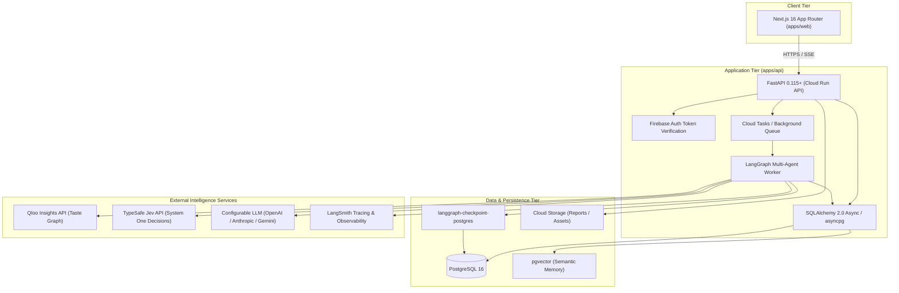

# Architecture Specification — System Overview

## 1. System Vision & Objective
**Cultura** is an AI Cultural Intelligence SaaS platform that provides empirical market entry intelligence for brands, agencies, and businesses. Given a brand profile and target geographical markets, Cultura determines cultural compatibility, provides Qloo taste graph evidence, outputs a probabilistic Launch / Adapt / Avoid recommendation via TypeSafe Jev, and enables interactive what-if simulations.

## 2. Architecture Style: Modular Monolith
Cultura adopts a **Modular Monolith** architecture with separated runtime deployment targets rather than distributed microservices:

## 3. Runtime Services
1. **Web Frontend (`apps/web`)**: Next.js 16 App Router hosted on Cloud Run. Server-Side Rendering (SSR) for static/marketing pages and dynamic client hydration for the analytical dashboards and real-time SSE progress views.
2. **API Service (`apps/api`)**: Python 3.12 FastAPI service handling authenticated REST requests, user authorization, workspace scoping, project management, and queueing analysis runs.
3. **Agent Worker (`apps/api` worker entrypoint)**: Asynchronous task consumer triggered via Cloud Tasks (or background worker in dev) executing the LangGraph agent graph.

## 4. Key Architectural Invariants
1. **Zero Client Secrets**: No third-party API keys (Qloo, Jev, LLM, Firebase Private Keys) are ever exposed to the client browser.
2. **Deterministic Grounding**: No LLM is permitted to invent cultural affinity scores. Cultural scores are strictly calculated by the deterministic compatibility scoring engine.
3. **Evidence Traceability**: Every analytical assertion made in reports or chat must reference a persisted `evidence_id` mapped to an audited Qloo API call.
4. **Resumable Execution**: Analysis runs are checkpointed per step in PostgreSQL, enabling failure recovery and seamless resumption.
