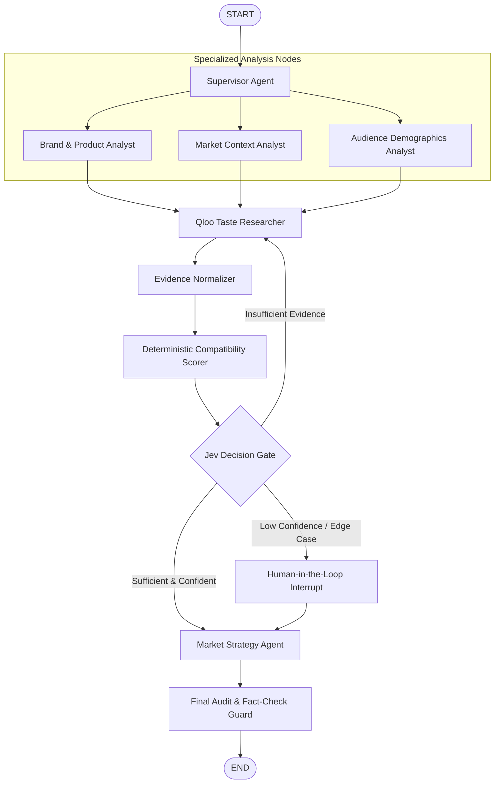

# Architecture Specification — Agent Orchestration

## 1. Multi-Agent Paradigm
Cultura uses **LangGraph** to implement a bounded, deterministic Directed Acyclic Graph (DAG) with controlled cycles for evidence gathering and human-in-the-loop gates.

## 2. LangGraph State Machine

## 3. Node Responsibilities & Contracts

### 3.1 Supervisor Node
- **Input**: User goal, project snapshot, candidate markets, and strategy assumptions.
- **Role**: Plans the research tasks, verifies input validity, and constructs the initial agent execution state.
- **Output**: `ExecutionPlan` with designated market sub-tasks.

### 3.2 Brand Analyst Node
- **Role**: Analyzes the brand's positioning, product categories, price points, and identifies cultural proxy hypotheses (e.g., related lifestyle brands, music subcultures, dining preferences).
- **Output**: `BrandProfile` with Qloo entity query candidates.

### 3.3 Market Context Analyst Node
- **Role**: Structures candidate markets (e.g., Tokyo, London, Mumbai), defines localized demographic boundaries, and formulates market-specific research queries.
- **Output**: `MarketResearchSpecs`.

### 3.4 Audience Demographics Analyst Node
- **Role**: Maps target age groups, psychographics, and cultural dimensions to test against candidate locations.

### 3.5 Qloo Researcher Node
- **Role**: Executes bounded, typed queries against the Qloo Insights API:
  - Entity Resolution (`/v2/insights/entities`)
  - Cross-domain Affinities (`/v2/insights/audiences`)
  - Location Heatmaps & Trends (`/v2/insights/locations`)
- **Output**: Raw Qloo API response payloads with request hashes and latency metadata.

### 3.6 Evidence Normalizer Node
- **Role**: Transforms raw external responses into canonical `evidence` records:
  - Deduplicates signals across queries.
  - Formats human-readable explanations.
  - Assigns unique `evidence_id`s stored in PostgreSQL.

### 3.7 Deterministic Compatibility Scorer
- **Role**: Executes the mathematical scoring algorithm across dimensions (Brand Affinity, Category Ecosystem, Audience Overlap, Location Relevance, Evidence Completeness).
- **Output**: Normalized scores (0.00 – 1.00) stamped with `score_version`.

### 3.8 TypeSafe Jev Decision Gate
- **Role**: Submits the structured state snapshot to Jev System One model to obtain a typed classification:
  - `decision`: `launch` | `adapt` | `avoid`
  - `confidence`: `0.00` – `1.00`
  - `probabilities`: `{"launch": 0.82, "adapt": 0.15, "avoid": 0.03}`
- **Fallback**: If Jev is unreachable, deterministic thresholds route the state safely.

### 3.9 Market Strategy Agent
- **Role**: Synthesizes normalized evidence and Jev classifications into strategic recommendations:
  - Localized product adaptations.
  - High-affinity cultural partnerships / influencers.
  - Launch sequencing and messaging guardrails.
  - Every strategic point must cite supported `evidence_ids`.

### 3.10 Final Audit Guard
- **Role**: Programmatically verifies that all assertions made in the strategy text correspond to valid evidence in state. Flags any unsupported claims before completing the run.

## 4. State Persistence & Checkpointing
LangGraph checkpoints every state transition into PostgreSQL using `langgraph-checkpoint-postgres`. If a worker instance fails or restarts mid-run, execution resumes from the last completed node without re-running expensive Qloo queries.
